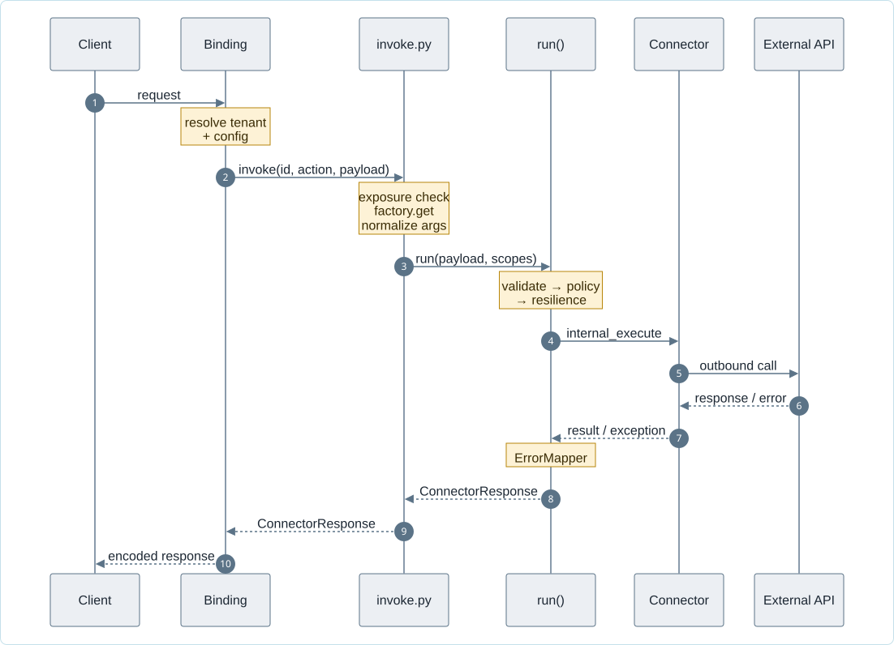

<!--
SPDX-FileCopyrightText: 2026 AOT Technologies

SPDX-License-Identifier: Apache-2.0
-->

# Node Wire architecture

Node Wire is a three-layer Python platform that runs connector adapters over REST, gRPC, or MCP. Each connector talks to an external system (for example, Google Drive, SMTP, Stripe); the runtime provides a consistent execution contract, error handling, and resilience.

This page is the overview. The detail lives on the topic pages. Read them in this order (the [reading map](reading.md) has the whole path):

| Page | Answers |
|---|---|
| This page | What the three layers are, and how a request moves through them |
| [Domain](architecture/domain.md) | What *connector*, *action*, `ConnectorResponse`, `ErrorCategory`, *tenant pin* and *named config* mean |
| [Seams](architecture/seams.md) | Where the layers hand off: `ConnectorFactory`, `invoke.py`, `PolicyHook`, `SecretProvider`, `AuthProvider`, `ErrorMapper` |
| [The `run()` pipeline](#the-run-pipeline) | What happens to every action, in order |
| [Tenancy](architecture/tenancy.md) | Tenant resolution, entitlement, tenant secrets, MCP tenant tools |
| [Bindings](connector-bindings.md) | How an action becomes a REST route, an MCP tool and a gRPC method |

## High-level architecture

The platform is split into three layers:

- **Layer A – Runtime** (`src/node_wire_runtime/`): The engine that every connector runs inside. It defines the execution contract, a standard error taxonomy, retries and circuit breaking, and telemetry.
- **Layer B – Connectors** (`src/node_wire_<connector>/`): Adapters that implement that contract and call external systems (HTTP Generic, SMTP, Stripe, Google Drive, FHIR Epic, FHIR Cerner, Salesforce, Slack). Each connector has its own input/output schema and business logic.
- **Layer C – Bindings** (`src/bindings/`): How the platform is exposed to the outside world—REST API, gRPC server, MCP server—and `ConnectorFactory`, which builds tenant-pinned connector instances. The factory reads `config/connectors.yaml` at startup (an external input, not part of the layer) and bootstraps it into the runtime `ConnectorConfigStore` (Layer A).

External callers reach the platform over REST, gRPC, or MCP. Each binding adapter resolves
transport-specific tenant and caller identity, then hands off to the shared invoke seam, as
the following diagram shows:

### Request lifecycle

The following sequence follows one request from the client to the external API:

A failure anywhere in `run` is mapped by `ErrorMapper` into the same `ConnectorResponse`
envelope with an `ErrorCategory` — bindings translate that to an HTTP status, a gRPC code,
or an MCP tool error, but the connector contract is identical on all three.

---

## Layer A – `runtime`

**Purpose:** Provide shared execution and reliability so every connector behaves in a consistent way (validation, errors, retries, telemetry) without each connector reimplementing the same plumbing.

**Location:** `src/node_wire_runtime/`

### Main components

- **BaseConnector**: Abstract base class for all connectors. It owns the [`run()` pipeline](#the-run-pipeline).
- **ConnectorResponse / ErrorCategory / ErrorMapper**: the response envelope, the error taxonomy (`RETRYABLE`, `BUSINESS`, `AUTH`, `FATAL`), and the per-connector exception mapping. See [Domain](architecture/domain.md#results-and-errors).
- **Resilience**: retries (Tenacity) and the runtime's own circuit breaker, which counts only upstream-health failures, once per invocation.
- **PolicyHook, SecretProvider, AuthProvider**: pluggable seams the factory injects. See [Seams](architecture/seams.md).
- **ConnectorConfigStore and tenant pinning**: per-tenant named configs, and instances bound to one tenant. See [Tenancy](architecture/tenancy.md).
- **Telemetry**: OpenTelemetry integration for tracing.

### The `run()` pipeline

Every action goes through the same sequence. The tenant pin is checked before the
trace span opens; everything after it runs inside the span, as the following diagram shows:

---

## Layer B – `connectors`

**Purpose:** System adapters that talk to external services. Each connector defines input/output models and declares its actions with `@sdk_action` (or its alias `@nw_action`) or `action_specs`. Connectors do not implement `internal_execute` — `BaseConnector.internal_execute` dispatches to the declared action. Hand-written connectors subclass `BaseConnector`; OpenAPI-generated ones subclass `RestConnector`. `ConnectorFactory` injects the tenant-scoped `SecretProvider`, `AuthProvider`(s), and `PolicyHook` when it builds an instance.

**Location:** `src/node_wire_<name>/`

### Common structure

- `schema.py`: Pydantic models for request and response.
- `logic.py`: Connector class and external service logic, including an optional `error_map` class attribute that registers the connector's exception mappings — scoped to that connector's own `connector_id` so they can never be resolved for another connector's errors.
- `normalizers.py` (optional): MCP argument normalizers that map LLM aliases to canonical fields before `run()` (wired via `mcp_normalize` on the action).

---

## Layer C – `bindings`

**Purpose:** Expose connectors over different protocols and build tenant-pinned connector instances from configuration (read from `config/connectors.yaml`, held in the runtime config store).

**Location:** `src/bindings/`

### Binding invoke

REST, MCP, and gRPC share one invoke seam in `src/bindings/invoke.py` ([Seams — `invoke.py`](architecture/seams.md#invokepy)). Transport-only concerns stay in each binding.

### Bindings offered

- **REST API (FastAPI)**: Dynamic routes at `POST /connectors/{connector_id}/{action}`.
- **gRPC Server**: Protocol buffers based interface on port 50051.
- **MCP Server**: Model Context Protocol implementation for AI agents.

What each binding does to arguments and errors: [Connectors on REST, MCP and gRPC](connector-bindings.md).
